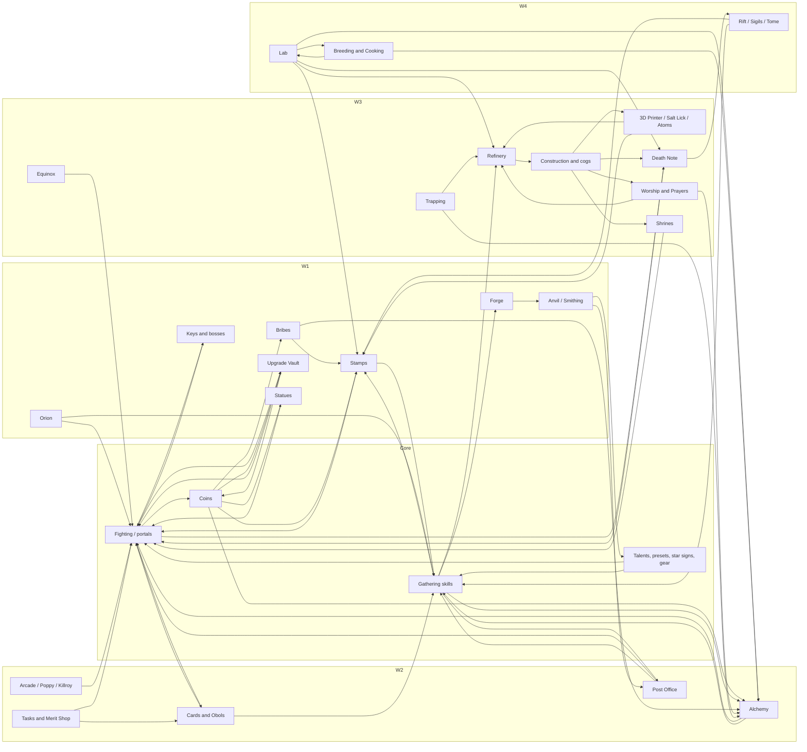

# The cross-System Leverage model: Stages, feed graph, Priority Lists and Roles (2026-10-17)

Ticket: [#26](https://github.com/YassSoliman/idleon-forge/issues/26), part of map [#1](https://github.com/YassSoliman/idleon-forge/issues/1). It is the synthesis of the eight System Dossiers ([#18](https://github.com/YassSoliman/idleon-forge/issues/18)–[#25](https://github.com/YassSoliman/idleon-forge/issues/25)) and the priority verification ([#27](https://github.com/YassSoliman/idleon-forge/issues/27)), and it fills the *contents* of the Knowledge Base shape fixed in [#11](https://github.com/YassSoliman/idleon-forge/issues/11). Terms follow [GLOSSARY.md](../../GLOSSARY.md). Precedence follows [ADR 0004](../adr/0004-source-precedence.md), numbers follow [ADR 0005](../adr/0005-toolbox-numbers-not-our-formulas.md), and the generated-vs-authored split follows [ADR 0007](../adr/0007-generated-facts-authored-judgment.md).

**Current patch:** game v1.23 "Lumi Menagerie" (2026-10-16/17). Toolbox pins used by the inputs: `6827d3f` (2026-10-17, gameVer 2.3.540) for the dossiers and `f1e4240` (2026-10-16, 2.3.531) for the hypothetical-math spike. A Toolbox clone at `6c37e3d` (2026-10-17) was read for one field (`finishedWorlds`, below). Royal Guardian shipped 2026-08-25. Roster advice from before that date is flagged pre-RG.

**Rule of precedence for this doc:** where `research/priority-verification` (abbreviated **PV**, row numbers like *PV 5.2*) corrects or contests a dossier, PV wins. The Discord addendum on #27 adds no new orders. Its image guides are tier 3, from 2025 or earlier, and agree with the PV refinery and construction orders.

## Answer

- **Stage is a pure function of the Account State.** It has 10 values, W1-early through W4-entry. Each is decided in order by save fields that the parsed Account State already exposes: `account.finishedWorlds.World1..3` (Toolbox marks a world done once any character has spoken to its gatekeeper NPC), the highest `characters[].level`, subclass `classIndex`, `npcDialog` quest progress, `account.towers` levels and `account.refinery.salts[].unlocked`. The W2 fixture account is **W2-late**. The W3 fixture account is **W3-early**.
- **The feed graph has three hubs:** coins (into Stamps, Bribes, the Upgrade Vault and Statues), fighting kills (into portals, the Death Note, Vault scaling and drops), and the Refinery → Construction → {3D Printer, Death Note, Salt Lick, Library, Shrines, Atom Collider} chain in W3. Lab, Cooking and Breeding in W4 form one closed loop, and the Lab node multiplies W1–W3 Systems (stamps ×2, vials ×2, refinery ×3, kills ×2).
- **Every Stage's Priority List has the same frame.** Position 1 is the **never-skip, time-gated** group: keys before the 3-day bank, daily buys and attempts, minigame plays and Random Events (they don't bank), salts (manual refine), and the Death Note building. Position 2 is the **pusher's next portal**, the 2026 community norm (PV cross-cutting 1). Position 3 is **free-value fills** (empty slots). Below that come the Stage's System items, ranked from the dossiers as corrected by PV.
- **The pusher is decided by arithmetic, not opinion.** Sources contest Barbarian vs Squire (W1–W3) and DK vs ES (W4+). The model keeps both sides and picks, per account, the character with the highest Toolbox `finalKillsPerHour` on the next unopened map. That is the `getMaxDamage` clone verified in `research/hypothetical-math`.
- **Roles (the Meta Path):** slots 1–6 are one of each subclass, slot 7 is Journeyman, slot 8 is a 2nd Squire (→ DK → RG), slots 9–10 are contested (2nd AC / DB / ES) and slot 11 stays a Beginner. Each Role owns a skill and some account-wide actions (Squire: Construction and Refinery Throttle; Hunter: Eagle Eye and Trapping; Wizard: Worship, Charge Syphon and prayer slots; Shaman: Alchemy; Barbarian: fishing and AFK fighting; Bowman: catching and the Archer-line anvil). Roles set Visit-Order hints and "better fit" swaps, both checked by Toolbox efficiency or kills/h before they are shown.
- **Worked example, W2 account (W2-late):** what fires is mostly free value. All 11 vial attempts are unused, Water is at cap, Arcade balls have been capped for about 96 h, 0 big bubbles are equipped on 5 characters, 3 of 5 characters have no cards, 3 of 5 have no tools, the W2 obol merit is at 0, and there are 0 constellations. The push Goal is Djonnut → Efaunt → Glacier Quartz.
- **Worked example, W3 account (W3-early):** what fires is the W3 engine sitting idle. The Death Note building is at 0 (no multikill), Explosive Salt is unlocked but off, Hoggindaz 1 is not finished, 2 of 6 characters have no printer sample, there are 0 skulls and 0 traps, both shrines sit in town, keys are banked 2 days, and 4 obols are unequipped. Keeping both Squires is the PV ruling, and a Hunter is the next new character.
- **Contested items are never the top action** (#11). They carry a "sources disagree" badge: first Gem Shop buy, pusher class, cogs (Build Rate vs EXP), prayers, shrines, W3 merit order, armor ladder vs Amarok-forever, Larry timing, and late-game DR vs skill obols.
- **Open:** a few gaps remain before the Knowledge Base can be authored.
  - Map-progress sub-staging (which map the pusher has opened) would sharpen the W1–W3 early/mid/late split, but no Detector reads it yet.
  - The Equinox flag in Toolbox is wrong on pre-W3 saves.
  - Several orders stay unverified (L): Vault rows, Guild, cards per stage, Salt Lick, jewels, cooking discovery.
  - The W4-entry list has never been tested on a real save.

## 1. Stage definitions

A Stage is **account-level** (#11 item 7). Per-character variation comes from class and level filters on each entry (`appliesTo`). The Detector evaluates the rows below **top to bottom and takes the last row whose condition holds**, so every account has exactly one Stage. All fields are in the parsed Account State (`{account, characters}`, Toolbox parsers). "Highest Lv" means `max(characters[].level)`.

### 1.1 The milestone facts the Stages use (all H: game data or code)

| Milestone | Gate | Account State field | Source |
|---|---|---|---|
| World N finished | Any character has dialogue with the world's gatekeeper: Builder_Bird (W1), Constructor_Crow (W2), Carpenter_Cardinal (W3) | `account.finishedWorlds.World1/2/3` (true/false); `account.currentWorld` = last finished + 1 | Toolbox `parsers/quests.ts` `isWorldFinished` and `parsers/index.ts` L265–276 at `6c37e3d` |
| Stamps and Bribes | Highest Lv ≥ 14, then buy Mr Pigibank | `max(characters[].level)`; `account.accountOptions[248]` | [W1 amarok-and-quests, gate table](https://github.com/YassSoliman/idleon-forge/blob/research/w1-systems/docs/research/systems/w1-systems/amarok-and-quests.md#w1-quests-and-town-unlocks-that-gate-systems) (N.js town thresholds 7/14/18/22/28) |
| Forge / Statues / Tasks | Highest Lv ≥ 18 / 22 / 28 | same; `accountOptions[249/250/251]` | same |
| Builder Bird (W2 portal NPC) | Highest Lv ≥ 17 plus the Desert Topaz from Amarok | `npcDialog.Builder_Bird` | same |
| Obol Altar | Highest Lv ≥ 30 | `max(level)` | [cards-obols, Obols Unlocks](https://github.com/YassSoliman/idleon-forge/blob/research/cards-obols/docs/research/systems/2026-10-17-cards-obols.md#obols) |
| Subclass taken | Speccius (W2), no level gate; base classes 7/19/31 become 8/9, 20/21, 32/33 | `characters[].classIndex` | [W2 quests that gate systems](https://github.com/YassSoliman/idleon-forge/blob/research/w2-systems/docs/research/systems/2026-10-17-w2-systems.md#w2-quests-that-gate-systems) |
| Post Office | Highest Lv ≥ 50, plus 5 Empty Boxes | `max(level)`; `npcDialog.Postboy_Pablob` | [W1 post-office](https://github.com/YassSoliman/idleon-forge/blob/research/w1-systems/docs/research/systems/w1-systems/post-office.md) |
| Efaunt access, daily Efaunt keys | Djonnut quests in Djonnuttown (last W2 area) | `characters[].npcDialog.Djonnut`; `account.currencies.KeysAll[1].amountPerDay` | W2 dossier, W2 bosses and keys |
| W3 tutorial done | Hoggindaz 1–5 | `account.quests.Frostbite_Tundra[Hoggindaz].npcQuests[0..4].progress[].status` (1 = done, 0 = in progress, −1 = not started; reading per Toolbox `getQuests`) | [W3 quests](https://github.com/YassSoliman/idleon-forge/blob/research/w3-systems/docs/research/systems/w3-systems/shrines-prayers-equinox-bosses-quests.md#w3-quests-frostbite-tundra) |
| Multikill on | Death Note building Lv ≥ 1 | `account.towers.data[name=Death_Note].level` | [Death Note](https://github.com/YassSoliman/idleon-forge/blob/research/w3-systems/docs/research/systems/w3-systems/worship-trapping-death-note.md#death-note) |
| 3D Printer | Building Lv = number of characters that can print | `account.towers.data[name=3D_Printer].level` | [construction, 3D Printer](https://github.com/YassSoliman/idleon-forge/blob/research/w3-systems/docs/research/systems/w3-systems/construction.md#3d-printer) |
| Late-W3 salts | Each salt unlocks by spending the previous one; Nullo is salt 6 | `account.refinery.salts[i].unlocked` | [construction, Refinery](https://github.com/YassSoliman/idleon-forge/blob/research/w3-systems/docs/research/systems/w3-systems/construction.md#refinery-and-salts) |
| Elite class | Eliteus, map 154, 10 genies, **no level gate** | `characters[].classIndex` (elite indices) | [W4 Elite class unlock](https://github.com/YassSoliman/idleon-forge/blob/research/w4-systems/docs/research/systems/w4-systems/2026-10-17-rift-sigils-tome-bosses-elite.md#elite-class-unlock-eliteus) (PV 7.11 conflict resolved: the code reading wins, so the "Elites at Lv 70" line in `companions-guild-family` refers only to the family-bonus offset) |
| Character slots | Family level (= `account.accountLevel`, the sum of class levels) 8 / 30 / 70 / 150 / 300 / 500 / 750 / 1,100 / 1,500 / 5,000 → slots 2–11 | `account.accountLevel`; `characters.length` | [companions-guild-family, Family level unlocks](https://github.com/YassSoliman/idleon-forge/blob/research/account-wide/docs/research/systems/account-wide/companions-guild-family.md#family-level-unlocks) (wiki Character_Creation rev 2026-10-07; Toolbox `newCharacters` alert) |

### 1.2 The Stages

| Stage | Condition (all must hold; evaluated in order, last match wins) | What it means on the Meta Path |
|---|---|---|
| **W1-early** | `!finishedWorlds.World1` and highest Lv < 14 | First 1–3 characters. Owl, Vault, Anvil and cards are open. Stamps are not |
| **W1-mid** | `!World1` and highest Lv ≥ 14 | Stamps, Bribes, then the Forge (18) and Statues (22) open |
| **W1-late** | `!World1` and (highest Lv ≥ 28 **or** any `npcDialog.Dog_Bone > 0`) | Tasks and Merits open. The pusher is at the Amarok door |
| **W2-early** | `World1 && !World2` and (any character with `classIndex ∈ {7,19,31}`, i.e. a base class not yet subclassed, **or** highest Lv < 30) | Alchemy, Arcade and subclass quests. Obols are not yet open |
| **W2-mid** | `World1 && !World2`, every promoted character subclassed, highest Lv ≥ 30 | Obols, bubbles to AutoReview tier 1, Poppy |
| **W2-late** | `World1 && !World2` and (any `npcDialog.Djonnut > 0` **or** highest Lv ≥ 50) | Djonnut, then Efaunt, then the Glacier Quartz. The Post Office opens |
| **W3-early** | `World2 && !World3` and (Death Note Lv 0 **or** 3D Printer Lv 0 **or** no character has Hoggindaz 5 done) | The W3 engine is not yet running |
| **W3-mid** | `World2 && !World3`, Death Note ≥ 1, 3D Printer ≥ 1, Hoggindaz 5 done | Bellows keys, Worship and Trapping, Dioxide and Purple salts |
| **W3-late** | `World2 && !World3` and `refinery.salts[5].unlocked` (Nullo) | Atom Collider, Chizoar, the W4 gate |
| **W4-entry** | `finishedWorlds.World3` | Gobo, elites, the Lab. The list below covers W4 until every subclass character has its elite. Later W4 sub-stages are out of this ticket's scope |

Notes:
- The thresholds are **game gates** (H). Choosing them as Stage boundaries is our judgment (authored, ADR 0007). The early/mid/late split inside a world mirrors the dossiers' own "Min-max by stage" bands, which all key on these unlocks.
- A later refinement could add the pusher's furthest opened map (`characters[].kills` / `nextPortal`, Toolbox `portals.ts`) as a sub-stage signal. It is listed as open question Q1.
- The W3-late condition could also use "Chizoar killed" (a Galaxial Amethyst in storage). The rawName (`Crystal3`, by analogy with `Crystal2` = Glacier Quartz) is unverified, so only Nullo is used for now.

### 1.3 The two fixture accounts as worked examples (aggregates only)

| | W2 fixture account | W3 fixture account |
|---|---|---|
| `finishedWorlds` | World1 true, World2 false | World1 true, World2 true, World3 false |
| Characters, highest Lv, family level | 5, Lv 60, 257 | 6, Lv 85, 379 |
| Subclasses | all 5 subclassed (Barbarian, Squire, Shaman, Bowman, Wizard) | all 6 subclassed (Wizard, Squire ×2, Bowman, Barbarian, Shaman) |
| Deciding rows | W2-early fails (no base class left, Lv ≥ 30). W2-late holds: `npcDialog.Djonnut > 0` on 2 characters and highest Lv 60 ≥ 50 | W3-early holds: Death Note building Lv 0, and Hoggindaz 1 is in progress on one character with none done |
| **Stage** | **W2-late** | **W3-early** |

## 2. The System feed graph

Edges are "A feeds B" as stated in each dossier's *Feeds / fed by* section (all H unless the dossier says otherwise). Only edges that matter for W1–W4 ranking are drawn.

### 2.1 Table

| System (dossier) | Feeds | Fed by |
|---|---|---|
| **Fighting / portals** (character-builds; hypothetical-math) | coins; kill counts (portals, Death Note, Vault kill rows, Tasks); drops (stamp materials, cards, obols after the W2 merit, crystal mobs → statues) | damage from every System below; food; Shrines on the map |
| **Coins** | Stamps, Bribes, Upgrade Vault, Gold statues, Alchemy Pay 2 Win, Forge and Anvil points; W4 kitchens | fighting |
| **Gathering skills** (skills dossiers) | stamp cap raises; ores → Forge bars; bubble and vial costs; refinery fuel (Spore Cap, Copper, Forest Fibres, Void Bar); Post Office orders; W4 Lab chips | tools (Anvil), stamps, bubbles, cards, obols, Post Office boxes, Owl Skill XP, Family |
| **Anvil / Smithing** ([W1](https://github.com/YassSoliman/idleon-forge/blob/research/w1-systems/docs/research/systems/w1-systems/anvil-smithing.md)) | gear and tools; Empty Boxes (Post Office unlock); stamp materials; Smithing EXP | coins, AGI, Anvil Zoomer stamp, Hammer Hammer bubble, Infinity Hammer gem buy, Vault |
| **Forge** | bars → gear, stamps, vials; Void Bar → Nullo salt | ores, coins, Vault |
| **Stamps** ([W1](https://github.com/YassSoliman/idleon-forge/blob/research/w1-systems/docs/research/systems/w1-systems/stamps.md)) | damage, skill efficiency, carry cap (which feeds stamps), talent points, card drop, Alchemy | coins; materials; Bribes; Hydrogen atom (W3); Lab Stamp Book ×2 (W4); Envelope Pile sigil; Gilded Stamps (Rift) |
| **Bribes** | stamp cost; AFK rates; 2nd bubble slot (Changing the Code) | coins |
| **Statues** | stats, skill power, Anvil speed, Alchemy EXP | crystal-mob drops (drop rate), Post Office, quests, coins (Gold) |
| **Orion the Owl** | Class XP, Skill XP, Drop Rate, damage, all stats; Equinox | time; Vault 21 |
| **Upgrade Vault** ([account-wide](https://github.com/YassSoliman/idleon-forge/blob/research/account-wide/docs/research/systems/account-wide/upgrade-vault.md)) | combat, coins, Class EXP, talent points, stamps, statues, Anvil, Forge, Owl, Alchemy, Post Office, Construction, critters and souls, W4 systems | coins; kill counts on maps 8/13/14/24/101 |
| **Cards / Obols** ([cards-obols](https://github.com/YassSoliman/idleon-forge/blob/research/cards-obols/docs/research/systems/2026-10-17-cards-obols.md)) | stats, AFK gains, drop rate, skill efficiency, Worship, Trapping, Construction | kills (drops), the W2 obol merit, Gem Shop card slots, Lab chips |
| **Talents, presets, star signs, gear** ([character-builds](https://github.com/YassSoliman/idleon-forge/blob/research/character-builds/docs/research/systems/2026-10-17-character-builds.md)) | damage, AFK gains, skill efficiency; Refinery (Throttle), Construction (Redox Rates), Worship (Syphon), Trapping (Eagle Eye), 3D Printer (Sampling) | class and skill levels, stamps, vials, Vault, Library (W3), constellations |
| **Post Office** | per-character damage, skill efficiency, Anvil speed, drop rate | stored resources, Anvil products, bars, drops |
| **Alchemy** (bubbles, vials, liquids, P2W) ([W2](https://github.com/YassSoliman/idleon-forge/blob/research/w2-systems/docs/research/systems/2026-10-17-w2-systems.md)) | stats and damage, skill efficiency and multi-resource, drop rate, Anvil, Construction, Trapping, Worship, Class EXP, AFK, talent points | W1–W3 materials, liquids, coins (P2W), Bribe (slot 2), Breeding (slot 3), Lab (NBLB) |
| **Arcade / Poppy / Killroy / Ballot** (W2 dossier; minigames) | base damage, accuracy, Class XP, liquid cap, refinery speed, sample size; talent points; Equinox | time (balls bank 48 h + stamps); weekly runs |
| **Tasks → Merit Shop** ([achievements-tasks-merit](https://github.com/YassSoliman/idleon-forge/blob/research/account-wide/docs/research/systems/account-wide/achievements-tasks-merit.md)) | obol drops (W2), AFK gains, respawn, boss recipes, build/food slots (W3), NBLB and egg capacity (W4); gems; Anvil recipes | almost every System's activity |
| **Gem Shop** | Anvil slot, card slots, carry, storage, cauldrons, Crystal 3D Printer, tower slots | quests, task unlocks, achievements (Steam), Pet Mart, Liquid Shop |
| **Keys and bosses** (resets dossier; W1/W2/W3 bosses) | world portals (Desert Topaz → W2, Glacier Quartz → W3, Galaxial Amethyst → W4), boss gear, cards, gems (W2 merit) | Dog Bone / Djonnut / Bellows quests per character, Colosseum, Post Office |
| **Refinery** ([construction](https://github.com/YassSoliman/idleon-forge/blob/research/w3-systems/docs/research/systems/w3-systems/construction.md)) | every Construction payment, Salt Lick, Squire damage and build speed | 3D Printer fuel, AFK farming, critters (Dioxide, Purple), souls (Dioxide, Nullo), Void Bars |
| **Construction** (+ cogs) | 3D Printer, Library, Death Note, Salt Lick, Trapper Drone, Worship towers, Shrines, Atom Collider | salts; build rate from characters on the Cog Board or Shelf (Squires) |
| **3D Printer / Salt Lick / Atom Collider** | refinery fuel, stamp materials, Post Office, bubble costs; Hydrogen → stamp cap-raise cost | AFK gain rates (samples); salts; storage overflow |
| **Worship / Prayers** ([worship-trapping-death-note](https://github.com/YassSoliman/idleon-forge/blob/research/w3-systems/docs/research/systems/w3-systems/worship-trapping-death-note.md)) | souls → prayers, vials, stamps, Dioxide and Nullo salts; prayers → EXP, efficiency, drop rate, printer, Death Note kills, giants (quests) | charge per character, skull, totems, towers (Construction), Wizard talents |
| **Trapping** | critters → vials, stamps, bubble costs, Dioxide and Purple salts, Smithing | traps on every character, Hunter's Eagle Eye, Trapper Drone |
| **Death Note** | multikill (kills, resources, portals), Rift Eclipse Skulls, Tome, Voidwalker gate | all fighters' kills; building level |
| **Shrines** | damage, HP, drop rate, EXP and respawn on their map | AFK time on their map; Construction |
| **Equinox** | damage, drop rate, talent levels, Killroy, Worship TD, Cooking, Lab | time; clouds (refinery, dungeons, etc.) |
| **Lab** ([W4 lab](https://github.com/YassSoliman/idleon-forge/blob/research/w4-systems/docs/research/systems/w4-systems/2026-10-17-lab.md)) | stamps ×2, vials ×2, refinery ×3, kills ×2 (portals and Death Note), NBLB bubbles, sigils, shrines, printer | characters AFK on Laboratory; meals and spices (chip and jewel costs) |
| **Breeding / Cooking** | spices → meals; meals → damage, Lab, Breeding; Arena wave 100 → 3rd bubble slot | each other; Lab jewels |
| **Rift / Sigils / Tome** | Skill Mastery, Infinite Stars, Gilded Stamps, Eclipse Skulls; Envelope Pile → stamps; Tome → damage | elites (DK/ES/SB gates), character count, kills; Lab node 12 (sigils); almost everything (Tome) |
| **Family / Guild / Pets** ([companions-guild-family](https://github.com/YassSoliman/idleon-forge/blob/research/account-wide/docs/research/systems/account-wide/companions-guild-family.md)) | stats, Class EXP, efficiency, carry; character slots and family obol slots | character levels (family level), GP, pet crystals |

### 2.2 Diagram

**Leverage read of the graph (arithmetic on edges, no weights):** a System's out-degree inside the account's current Stage is a tie-break signal (#11's "most Goals per activity"), not a weight.
- **Coins** and **Fighting** feed the most nodes in W1–W2.
- In W3, **Refinery** has the highest fan-out: everything in Construction pays in salt. **Construction** gates 7 Systems.
- In W4, the **Lab** feeds back into the W1–W3 Systems with ×2/×3 multipliers.

This matches the dossiers' rankings: stamps are "the biggest W1 lever", Alchemy is "W2's top Leverage", and Lab, Cooking and Breeding are "one loop".

## 3. Priority Lists per Stage

### 3.0 How to read them

- **Order:** by #11 item 6, ranking is Verdict blockers, then Priority List position, then the arithmetic tie-breaks (cheapest, then closest Milestone, then most Goals per activity). Equal position numbers are **ties**. There are no weights anywhere.
- **Verdict blockers** are not in these lists. They are AFK-safety Checks evaluated per character against the Expected Return: food, wrong preset for the activity, Unending Energy with a return over 10 h, worship charge or anvil product or liquid capping, traps ending early. They come from the dossiers' *Per-session actions* and the Toolbox alerts.
- **Shared frame (every Stage):**
  - **Position 1, never skip (time-gated).** The PV cross-cutting norm, as applied by the brief, is that time-gated Systems are never skipped: salts, the Death Note, daily buys, keys, and minigame plays that don't bank. Each item fires only once its System is unlocked.
  - **Position 2, push.** "Push portals with one character until about W5/W6, then go back for Systems" (PV cross-cutting 1, confirmed: Reddit [1uhgyv7](https://www.reddit.com/r/idleon/comments/1uhgyv7/comment/ou7u438/) 2026-06-27, [1ue96lq](https://www.reddit.com/r/idleon/comments/1ue96lq/comment/otjt8qz/) 2026-06-24, [1v627db](https://www.reddit.com/r/idleon/comments/1v627db/comment/ozoen5n/) 2026-07-25). The Goal is "pusher opens the next portal". Its one Next Action is the next kill or quest step. The pusher is picked by arithmetic (§4.3).
  - **Position 3, free-value fills.** Empty slots that cost nothing to fill. They are cheapest by definition, so they tie and get ordered by the tie-break.
  - **Position 4 onward:** the Stage's System items.
- **Status column:** `confirmed`, `corrected` or `contested` cite a PV row. `unverified` means no dated community Source orders it (PV), so it stays dossier reasoning at low confidence.
- **Contested** entries are stored with both sides and never shown as the top action (#11 item 5).
- **Generated vs authored:** the numbers in the items (costs, thresholds) are generated game facts (ADR 0007), quoted here only for readability. The *order* is the authored part.

#### Shared position-1 block (never skip), by unlock

| # | Item (Goal or Check) | Detector (fires when) | Unlocks at | Dossier | Status |
|---|---|---|---|---|---|
| 1a | Collect banked boss keys before the 3-day cap | `currencies.KeysAll[k].amountPerDay > 0` and `daysSincePickup ≥ 2` (ActiveOn fires at 2; Toolbox at 3) | Dog Bone (W1), Djonnut (W2), Bellows (W3) | [resets, Boss keys](https://github.com/YassSoliman/idleon-forge/blob/research/account-wide/docs/research/systems/account-wide/resets-dailies-events.md#boss-keys); [amarok-and-quests](https://github.com/YassSoliman/idleon-forge/blob/research/w1-systems/docs/research/systems/w1-systems/amarok-and-quests.md) | confirmed (PV 7.14) |
| 1b | Daily, unbanked: Random Event; skill minigame plays (pool of 5 lost at reset; play only while a highscore Milestone is open); Darts and Hoops on cooldown | `accountOptions[137] == 0` and event live; `currencies.minigamePlays > 0`; Darts `OLA[439] ≤ 0` | W1 | [minigames](https://github.com/YassSoliman/idleon-forge/blob/research/account-wide/docs/research/systems/account-wide/minigames.md); [resets, Daily Checklist](https://github.com/YassSoliman/idleon-forge/blob/research/account-wide/docs/research/systems/account-wide/resets-dailies-events.md#daily-checklist) | unverified (mechanics H: "don't bank" is code). Darts > Orion > Poppy > Hoops is dossier M |
| 1c | Daily Alchemy buys: vial attempts, Liquid Shop first gems and Bargain Tag, cheap daily obols | `alchemy.p2w.vialsAttempts.current > 0`; Toolbox `alchemy.gems`, `alchemy.bargainTag` | W2 | W2 dossier, Vials and Liquids | unverified (order); mechanics H |
| 1d | Capped stockpiles that waste: liquids full, Arcade balls past 48 h + stamps, Poppy unconverted | `alchemy.liquids[i] ≥ liquidCauldrons[i].maxLiquid`; `now − timeAway.Arcade ≥ maxClaim` | W2 | W2 dossier (Liquids, Arcade, Poppy) | unverified (order); mechanics H |
| 1e | Weekly: Killroy rooms, Ballot vote, weekly boss with every character, guild weeklies | Toolbox `killRoy.general`; `weeklyBossesRaw` | W2 | W2 dossier, Killroy; resets, Weekly bosses | unverified (order) |
| 1f | **Salts:** manually Refine every full bar (Auto Refine never ranks up). Keep fuel for the Expected Return. Keep auto-refine **off** on Redox and Dioxide | Toolbox `rankUp`, `materials`; `refinery.salts[i].unlocked && !active` | W3 | [construction, Refinery](https://github.com/YassSoliman/idleon-forge/blob/research/w3-systems/docs/research/systems/w3-systems/construction.md#refinery-and-salts) | **corrected** (PV 5.2: Redox **and Dioxide**, never auto) |
| 1g | **Death Note building to Lv 1** as soon as Explosive allows (multikill is 0 until then) | `towers[Death_Note].level == 0` | W3 | [Death Note](https://github.com/YassSoliman/idleon-forge/blob/research/w3-systems/docs/research/systems/w3-systems/worship-trapping-death-note.md#death-note) | confirmed (PV 5.15) |
| 1h | Equinox bar full: spend it | `equinox.currentCharge ≥ chargeRequired` **and the Equinox Mirror is owned**. Toolbox's `equinox.unlocked` is true even on W2 saves, so it cannot be used | W3 (mirror) | [Equinox](https://github.com/YassSoliman/idleon-forge/blob/research/w3-systems/docs/research/systems/w3-systems/shrines-prayers-equinox-bosses-quests.md#equinox-w3-dreams) | mechanics H; the spend order is corrected (PV 5.10) |
| 1i | W4 shop dailies: 3 Pile of Processor Chips (once), 7 Strung Jewels (once), Blue Tome Pages daily; buy rotating chips and jewels | `accountOptions[91] < 2`; Toolbox `laboratory.chipsRotation` | W4 | [Lab](https://github.com/YassSoliman/idleon-forge/blob/research/w4-systems/docs/research/systems/w4-systems/2026-10-17-lab.md); Tome | confirmed (PV 6.5, 6.10) |

#### Shared position-3 block (free-value fills), all Stages once unlocked

| # | Fill | Detector | Dossier | Status |
|---|---|---|---|---|
| 3a | Equip any stored obol into an empty slot of its shape, **family slots first**. Any stat beats empty | `account.obols.inventory` has a non-`Blank` item while a `characters[].obols.list[]` or `account.obols.list[]` entry is `Blank` (Toolbox `missingObols`, `familyObols`) | cards-obols, Obols | confirmed (PV 2.5) |
| 3b | 4+ cards on every character; switch card preset and set when the activity changes | equipped cards < `4 + gemShopPurchases[63]`; Toolbox `cardsAlert` | cards-obols, Cards | unverified (PV 2.1) |
| 3c | Fill every big-bubble slot with the bubble for its AFK Target (slot 2 after Changing the Code) | `characters[].equippedBubbles[i].bubbleName == null` (Toolbox `missingBubbles`; note its bribe quirk) | W2 dossier, Bubbles | unverified (order); mechanics H |
| 3d | Fill every tool slot; craft the highest tool the level allows | `characters[].tools` with blank slots; Toolbox `hasAvailableToolUpgrade` | character-builds, Equipment | confirmed for tools (PV 1.7; only armor is contested) |
| 3e | Second talent preset = the class's Skilling job; spend points on both | sum of `talentPreset` levels == 0 | character-builds, Talent presets | confirmed (PV 1.3) |
| 3f | Constellation A-2 (1 h AFK on Where the Branches End) → Chronus Cosmos (2 sign slots for everyone); then unlock every sign | `account.constellations[A-2].done == false`, or done with unspent star chart points | character-builds, Star signs | unverified (PV 1.6); "unlock every sign" is the standing Goal |
| 3g | Assign every character to a cauldron (W2+), the Cog Board or Shelf (W3+), a 3D Printer sample (W3+), and traps (W3+) | `alchemy.activities[i].activity == -1`; printer `Blank` for an unlocked character; `traps[i]` empty (Toolbox `missingTraps`) | W2 dossier; construction; worship-trapping | confirmed for traps (PV 5.14) and printer sampling (PV 5.3); the rest unverified |
| 3h | Spend unspent points: anvil points (all Speed), Post Office boxes, merits, unlock points, talent points | Toolbox `unspentPoints` (anvil, Post Office); `meritsDescriptions` affordable | anvil-smithing; post-office; merit | confirmed for Anvil Speed (PV 3.1) |

### 3.1 W1-early

| Pos | Item | Detector / filter | Dossier | Source (date) | Status |
|---|---|---|---|---|---|
| 1 | Never-skip block (1a not yet; 1b) | as above | | | |
| 2 | Push portals with one character. Slot 1 = a Warrior | the pusher's `nextPortal` | [community-guides](https://github.com/YassSoliman/idleon-forge/blob/research/community-guides/docs/research/2026-10-17-community-guides.md) | Idleon Academy 2025-09-23; Reddit 2026-06-27 | confirmed (PV cross-cutting 1) |
| 3 | Free-value fills (3b, 3d, 3e from Lv 15, 3f) | | | | see §3.0 |
| 4 | Orion: unlock (map 42). Feather Generation → Multiplier and Cheapener → **always buy Bonuses of Orion**. Restart and Mega Reset whenever affordable | Toolbox `featherRestart`, `megaFeatherRestart`; `owl.upgrades[0].level == 0` | [owl](https://github.com/YassSoliman/idleon-forge/blob/research/w1-systems/docs/research/systems/w1-systems/owl.md) | Incomplete Guide W1 (read 2026-10-17) | confirmed (PV 3.4) |
| 4 | Anvil: every hammer producing Thread; all points into Speed (Capacity only if a product fills before the Expected Return, by `getTimeTillCap`) | Toolbox `anvilOverdue`, `missingHammers`, `unspentPoints` | anvil-smithing | Incomplete Guide W1 | confirmed (PV 3.1) |
| 5 | Upgrade Vault, early table: Bigger Damage, Monster Tax, Natural Talent to 25 total; Wicked Smart and Bullseye; the three class rows at 95–99 total; Weapon Craft; Baby on Board | the current character's coins ≥ the cheapest priority row's `cost` | [upgrade-vault](https://github.com/YassSoliman/idleon-forge/blob/research/account-wide/docs/research/systems/account-wide/upgrade-vault.md) | formulas H; AutoReview vault tier 1 (2026-09-23) lists the rows, not their order | unverified (PV 7.6) |
| 6 | Make Warrior, Archer and Mage as slots 2–3 open (family 8, 30) | `characters.length < slotsUnlocked(accountLevel)` | companions-guild-family; community-guides | Academy 2025-09-23; OG_Rokoma 2025-10-28 | confirmed for the set (community-guides; PV 1st bullet) |
| 7 | Talent core: Gilded Sword → Sharpened Axe → 50 in the AFK-fighting talent (a Build entry) | per-class Build drift | character-builds, Build orders | Sir_Grimtide, Toolbox builds (2026-10) | unverified (PV 1.4, tier 3, current) |
| 8 | Kill each new map's mobs until its card drops (unowned cards drop 5× more) | card not owned for the AFK map's mob | cards-obols | TB `cards.json` | unverified (PV 2.1) |

### 3.2 W1-mid

| Pos | Item | Detector / filter | Dossier | Source | Status |
|---|---|---|---|---|---|
| 1 | Never-skip block (1b) | | | | |
| 2 | Push (toward the Amarok door: Scripticus 10) | | | | confirmed |
| 3 | Free-value fills | | | | |
| 4 | Bribes: **Insider Trading first**, then the rest of set 1; buy each set as it opens | `bribes[i].done == false && price ≤ coins` (no Toolbox alert, so ActiveOn's own) | [bribes](https://github.com/YassSoliman/idleon-forge/blob/research/w1-systems/docs/research/systems/w1-systems/bribes.md) | AutoReview bribes tier 1 | confirmed (PV 3.2) |
| 5 | Stamps: buy the shop stamps; level Sword, Heart, Mana, Target, Shield, Pickaxe and Hatchet with spare coins; Hamish's quest stamps | Toolbox `affordableStampLevels` | [stamps](https://github.com/YassSoliman/idleon-forge/blob/research/w1-systems/docs/research/systems/w1-systems/stamps.md) | AutoReview stamp tier 150 (2026-09-23) | unverified (PV 3.6) |
| 6 | Orion upkeep; Anvil upkeep (tie) | as 3.1 | | | confirmed |
| 7 | Statues: Town Marble's quest on the main character; deposit everything there, Power first | statues in storage; `npcDialog.Town_Marble < 3` | [statues](https://github.com/YassSoliman/idleon-forge/blob/research/w1-systems/docs/research/systems/w1-systems/statues.md) | Reddit 2026-06-02 | confirmed (PV 3.7) |
| 8 | Forge: never an empty slot; New Forge Slot and Speed, then Capacity | empty forge slot | [forge](https://github.com/YassSoliman/idleon-forge/blob/research/w1-systems/docs/research/systems/w1-systems/forge.md) | Incomplete Guide "always have ores smelting" | unverified (PV 3.3) |
| 9 | Vault: Major Discount 20 at once; Bored to Death; Knockout! Lv 1 then 5 | as 3.1 | upgrade-vault | formulas | unverified (PV 7.6) |
| 10 | Slots 4–6: the subclass trio your first trio did not take, so all six subclasses get covered | slot open, class line missing | companions-guild-family | Academy; PV ("one of each subclass first") | confirmed |

### 3.3 W1-late

| Pos | Item | Detector / filter | Dossier | Source | Status |
|---|---|---|---|---|---|
| 1 | Never-skip block (1a Dog Bone keys, 1b) | | | | |
| 2 | Push: kill Amarok → Desert Topaz → Builder Bird (W2) | `!finishedWorlds.World1` | amarok-and-quests | Incomplete Guide W1 | confirmed (PV 3.8) |
| 3 | Free-value fills | | | | |
| 4 | Dog Bone quests on **every** character (+1 key/day each) | `npcDialog.Dog_Bone ≤ 5` on a character that can reach the boss room | amarok-and-quests | game text (H) | confirmed (PV 7.14) |
| 5 | Merit Shop W1: **Hemoglobin ×3 → Amarok boots, pants and chest recipes → Boss Keys → Respawn → Hemoglobin to 10 by W3 → Bags → star talents** | merits ≥ next row cost | merit | Incomplete Guide W1 merit list | **corrected** (PV 7.1) |
| 6 | Tasks: claim reset-flag tiers the moment they are ready; Such Rock tiers (Amarok recipes) | ready tier unclaimed | merit, Tasks | game rule (H) | unverified (PV 7.12) |
| 7 | Stamps: **carry stamps first** (Lil' Mining Baggy, Matty Bag), then Anvil Zoomer, Fishing Rod, Catch Net; Pickaxe and Hatchet to 35+ | as 3.2 | stamps | AutoReview stamp tiers | unverified (PV 3.6) |
| 8 | Owl: Megafeathers toward Fractal (≥ 5, aim 10 before W3) | `owl.megaFeathers` count | owl; minigames | Incomplete Guide ("at least Fractal 5") | confirmed (PV 7.13) |
| 9 | Vault mid table: Boss Decimation, Sleepy Time, Drops for Days, Dirty Money (per power of 10 of Poop kills), Stamp and Statue Bonanza, Vault Mastery 10 | as 3.1, plus the kill-scaled ETA from Toolbox `finalKillsPerHour` | upgrade-vault; hypothetical-math | formulas H | unverified (PV 7.6) |
| 10 | Buy Vault combat rows only when a wall needs them (Bullseye when hit < 100% on the next map) | Toolbox `hitChance < 1` on the pusher's next map | upgrade-vault; character-builds | Academy ("accuracy is the #1 barrier"), Reddit 2026-07-25 | confirmed as a gate (PV cross-cutting 3) |
| 11 | Amarok gear (Slabs) for the pusher | Amarok recipe unlocked, set incomplete | character-builds, Equipment | Incomplete Guide: Amarok lasts "until late w5 or even world 6" | confirmed for crafting it; the later armor ladder is contested (PV 1.7) |

### 3.4 W2-early

| Pos | Item | Detector / filter | Dossier | Source | Status |
|---|---|---|---|---|---|
| 1 | Never-skip block (1a, 1b, 1c, 1d, 1e) | | | | |
| 2 | Push to the third W2 map (Crab Cakes) | | | Incomplete Guide W2 | confirmed |
| 3 | Free-value fills (3c and 3g cauldron added) | | | | |
| 4 | **Speccius subclass for every base character** (100 Kebab Sticks + 50 Crabby Cakey carried) | any `classIndex ∈ {7,19,31}` with level ≥ 10 | W2 quests that gate systems | Incomplete Guide W2; Reddit 2026-09-22 | confirmed (PV 4.8) |
| 5 | Alchemy: every character clicks the W2 cauldron and is assigned; unlock bubbles in all four cauldrons; level AutoReview tier-1 bubbles (class stat and multi, Hearty Diggy/Hocus Choppus, Tools, FMJ, Shaquracy, Prowesessary, Hammer Hammer) | `alchemy.activities[i] == -1`; `cauldrons.*.newBubble.expectedBubbles ≥ 1` | W2 dossier, Bubbles; skills alchemy | AutoReview bubbles tier 1 (2026-09-23) | confirmed (PV 4.1, 8.1) |
| 6 | Merit W2: **Obol ×1 → AFK gains (= character count) → Respawn → boss gems → obol drop rate → balls → Efaunt recipes (optional)**; skip Convert Better | `meritsDescriptions[1][0].level == 0` first | merit | Incomplete Guide W2 merit list | **corrected** (PV 7.2) |
| 7 | Obol Altar (Bob Joe Pickle) at highest Lv 30; then 3a | highest Lv ≥ 30 and altar quest not done | cards-obols | gist 2026-09-18 | confirmed (PV 2.5) |
| 8 | Arcade: Gold Ball Gain first (else Weapon Power or Class XP when it isn't in rotation) | `arcade.shop` active rotation | W2 dossier, Arcade | Reddit 2026-06-05; gist | confirmed (PV 4.6) |
| 9 | Bribe set 2, then save for Changing the Code (1.5M) | as 3.2 | bribes | AutoReview | confirmed (set by set); the Changing-the-Code ordering is unverified |
| 10 | Statues: Guilding Tools, then Gold in cost order (Power 99K, Speed 169K, Mining 284K …) | coins ≥ next Gold cost | statues | Reddit 2026-06-02 | confirmed (PV 3.7) |
| 11 | Stamps: Mutton and Wellington quest stamps, damage % stamps, Drippy Drop | | stamps | AutoReview | unverified |
| 12 | Cards: Easy Resources set on skillers, Yum Yum set on fighters at Lv 50+ | set Σ thresholds (H arithmetic) | cards-obols | TB `cards.json` | unverified (PV 2.2) |
| 13 | Poppy: unlock (Secret Map); open every session; reset spiral (tar-heavy, then fish-heavy, then reset for the discount) | `kangaroo.pendingFish > 0` | W2 dossier, Poppy; minigames | Discord pin 2025-02-22 (#27 addendum); Reddit 2025-03 / 2026-05 | unverified (PV 7.13, Poppy part) |
| 14 | **Gem Shop first buy** | gems ≥ price, nothing bought | [gem-shop](https://github.com/YassSoliman/idleon-forge/blob/research/account-wide/docs/research/systems/account-wide/gem-shop.md) | Side A: Infinity Hammer (AutoReview S; gist 2026-09-18). Side B: card slots + Crystal 3D Printer (Reddit 2026-10-04/05) | **contested** (PV 7.5). Both agree card slots are early and Ivory cauldrons drop to D |

### 3.5 W2-mid

Same frame as W2-early, minus item 4 (no subclass left to take), plus:

| Pos | Item | Detector / filter | Dossier | Source | Status |
|---|---|---|---|---|---|
| 4 | Spend banked brew: roll new bubbles while cheap, then Boost | `cauldrons.<c>.progress ≥ req` | W2 dossier, Bubbles | game (H) | unverified (order) |
| 5 | Merit W2 order (as W2-early 6) | | | | corrected (PV 7.2) |
| 5 | Obols: Bronze/Silver Pop at Gigafrog, reroll then combine; Silver Double Sixes from Yum-Yum mobs | fragments and stock | cards-obols | Reddit 2026-06-25/30 | confirmed (PV 2.6; note the community farms Gigafrog on an ES, a W4+ class) |
| 6 | Vials: unlock everything with ≥ 26% odds first, then the rare ones; brew-speed vials and Barium Mixture to Lv 3–5 | vial locked with its item in storage | W2 dossier, Vials | odds H | unverified (PV 4.5) |
| 7 | Liquids: P2W Water Regen and Capacity; Alchemy Lv 20 for N2, 35 for Trench | highest Alchemy level | W2 dossier, Liquids | wiki, AutoReview | unverified (PV 4.4) |
| 8 | Laaarrrryyyy: level when unlocked if materials allow, not a W2 gate | bubble unlocked | W2 dossier | Reddit 2026-06-02/07 vs AutoReview never listing it | **contested** (PV 4.2) |
| 9 | Vault late-W2 table (Straight to Storage, Bubble Money, Recipe for Profit, Vial Overtune …) | | upgrade-vault | formulas | unverified |
| 10 | Bobjoepickle daily, toward 100 for W3 | daily shop stock | community-guides | Incomplete Guide W2 | unverified (single tier-3 Source) |

### 3.6 W2-late

| Pos | Item | Detector / filter | Dossier | Source | Status |
|---|---|---|---|---|---|
| 1 | Never-skip block (1a incl. Efaunt keys, 1b–1e) | | | | |
| 2 | Push: Djonnut 1–2 on the pusher → Efaunt → Glacier Quartz → Constructor Crow (W3) | `!finishedWorlds.World2` | W2 dossier, W2 bosses and keys | game (H) for the chain | confirmed (push norm); chain H |
| 3 | Free-value fills | | | | |
| 4 | **Djonnut 2 on every character** (+1 Efaunt key/day each) | `currencies.KeysAll[1].amountPerDay < characters.length` (Toolbox counts dialogue > 6; the game uses > 5) | W2 dossier; resets | game (H) | confirmed (PV 7.14) |
| 5 | Post Office: Postboy Pablob (5 Empty Boxes from Anvil Tab 2, Smithing 15); then each character's class/skill boxes first (Civil War, then the skill box, then Civil War) | highest Lv ≥ 50, Postboy quest not done; Toolbox `unspentPoints`, `dailyShipments` | [post-office](https://github.com/YassSoliman/idleon-forge/blob/research/w1-systems/docs/research/systems/w1-systems/post-office.md) | Reddit 2026-06-06; gist | confirmed (PV 3.5) |
| 6 | Bubbles to AutoReview tier 2 before W3 | bubble levels vs tier | W2 dossier | AutoReview tier 2 "for starting W3" | confirmed (PV 4.1) |
| 7 | Merit W2 (rest of the corrected order); obol loop (W2-mid 5) | | | | corrected / confirmed |
| 8 | Owl Fractal 10 before W3 | megafeathers < 10 | owl; minigames | Incomplete Guide | confirmed (PV 7.13) |
| 9 | Family: when the next slot opens, make the missing subclass (usually Hunter); Baby on Board vault row while levelling it | `slotsUnlocked(accountLevel) > characters.length`; family-level gap to the next slot = arithmetic | companions-guild-family; PV adjudication | Reddit 2026-09-22 | confirmed |
| 10 | Save gems for the Crystal 3D Printer (875) before Construction | gems < 875 and W3 not reached | gem-shop | both sides of PV 7.5 rank the printer at the top by W3 | contested (first buy); the printer-at-W3 part is agreed |
| 11 | Vault late-W2 table | | upgrade-vault | | unverified |

### 3.7 W3-early

| Pos | Item | Detector / filter | Dossier | Source | Status |
|---|---|---|---|---|---|
| 1 | Never-skip block, including **1f salts** (turn on every unlocked salt, manual refine, Redox auto off) and **1g Death Note Lv 1** | | | | corrected / confirmed |
| 2 | Push (accuracy is the W3 wall; "access to systems > not having access") | | | Reddit 2026-07-25 | confirmed |
| 3 | Free-value fills, plus 3g (printer, cog seat, traps) | | | | |
| 4 | **Hoggindaz 1–5 on the first W3 character** (unlock the systems and both talent books) | `quests.Frostbite_Tundra.Hoggindaz[0..4]` not all done | W3 quests | Incomplete Guide W3 ("please dont ignore") | confirmed (PV 5.11) |
| 5 | Construction: pay every full bar; never an idle slot; build **3D Printer (to character count) → Cost Cruncher → Automation Arm → Library → Death Note → Salt Lick → Trapper Drone**; Pulse Mage and Fireball Lobber only to quest levels | Toolbox `construction.buildings`; `towers[...]` levels | construction | AutoReview `buildingsPreBuffs` (SS: Printer, Cost Cruncher, Automation Arm) | **corrected** (PV 5.1, 8.5) |
| 6 | 3D Printer samples: Spore Cap and Copper for Redox first, then each character's own skill resource | `printer[c][0].item == 'Blank'` for c < printer level | construction, 3D Printer | AutoReview sampling tiers; Reddit 2026-07-06 | confirmed (PV 5.3) |
| 7 | **Wax Skull and Cardboard Traps for every character** (tie) | `characters[].worship.maxCharge == 50`; `traps[c]` empty | worship-trapping | Incomplete Guide W3 | confirmed (PV 5.12, 5.14) |
| 8 | Cog Board: every character on the board or shelf; Squires/DKs on boosted squares; collect the shelf | builders not seated | construction, Cogs | builder meta: Reddit 2026-09 → 10 | confirmed (PV 5.6); **cog type contested** (PV 5.5: Build Rate early per gist 2026-09-18 vs EXP cogs per Reddit 2026-08-16 and the Incomplete Guide; store both) |
| 9 | Refinery ranking: Redox and Dioxide highest, others at about half the feeding salt's rank; Toolbox `getSaltsBalance` gives the safe max rank | `saltBalance` alert | construction | Reddit 2026-06-07, 08-16; gist | corrected (PV 5.2) |
| 10 | Shrines: move them from town onto the main AFK map (fact); first Woodular, then Isaccian | `shrines[i].mapId` not in `characters[].mapIndex` | shrines | AutoReview ranks Clover, Crescent, Undead higher | **contested** (PV 5.8) for the tiers; placement is H; the early Woodular/Isaccian step stays |
| 11 | Prayers: Tachion to Lv 2 (quest key, not disputed); the first prayers are contested (Royal Sampler 1 and Balance of Pain early per AutoReview vs Skilled Dimwit and Big Brain per dossier) | `activePrayers` empty | prayers | AutoReview prayer tiers | **contested** (PV 5.9) |
| 12 | Merit W3: Telekinetic ×1 + Library (gist) vs Build/Food slots first (dossier) | merits available | merit | gist 2026-09-18 | **contested** (PV 7.3) |
| 13 | Equinox spend order: Dreams → Resources → **Liquidvestment** (on unlock) → Slow Roast Wiz or Symbols → Matching Scims → Faux Jewels; **never Food Lust or Laboratory Fuse** | 1h | Equinox | Reddit 2026-10-14, 09-30; AutoReview Optional | **corrected** (PV 5.10) |
| 14 | Bubbles W3: Call Me Bob, Ash and Pope; aim for tier 3 before W4 | | W2 dossier | dossier L | unverified |

### 3.8 W3-mid

| Pos | Item | Detector / filter | Dossier | Source | Status |
|---|---|---|---|---|---|
| 1 | Never-skip block (now incl. Bellows keys) | | | | |
| 2 | Push | | | | confirmed |
| 3 | Free-value fills | | | | |
| 4 | Tachion → Snouts 3 and **Bellows 1–3 on the pusher, then every character** (+1 Chizoar key/day each) | `KeysAll[2].amountPerDay < characters.length` | W3 bosses and keys; W3 quests | game (H) | confirmed (PV 7.14) |
| 5 | Construction mid (AutoReview order continued): Salt Lick, Chest Space, Trapper Drone, Automation Arm to 3, Boulder Roller | as W3-early 5 | construction | AutoReview | corrected (PV 5.1) |
| 6 | Death Note: keep fighters on maps they overkill; W1 mobs to 25k → 100k, W2 mobs to 500k | `deathNote[w].mobs[].kills` vs `DEATH_NOTE_RANKS`; ETA = gap ÷ Toolbox `finalKillsPerHour` | Death Note; hypothetical-math | ranks H | confirmed as mandatory (PV 5.15); the order is unverified (M) |
| 7 | Worship: a Wizard with Charge Syphon and Nearby Outlet; Gorefest waves 10/25/51/81 for prayers; souls → Sippy Soul vial | charge ≥ 95% (Toolbox) | worship-trapping | dossier M | confirmed for skulls (PV 5.12); the rest unverified |
| 8 | Trapping: Lord of the Hunt quests (each +1 base critter); a Hunter's Eagle Eye in a preset collects for everyone | Hunter present; LotH progress | worship-trapping | Incomplete Guide; Academy | confirmed (PV 5.14) |
| 9 | Salt Lick: Printer Sample → obol slots → Refinery Speed … | | construction, Salt Lick | dossier opinion | unverified (PV 5.4) |
| 10 | Vault W3 table: Duplicate Entries (before redeeming tickets), Buildie Sheepie, Critters 'n Souls, All Armoured Up | | upgrade-vault | formulas | unverified |
| 11 | Statues: Gold through Bullseye | | statues | | confirmed (PV 3.7) |
| 12 | Tower Building Slots (gems) | | gem-shop | Discord tier list (2026-01/09 via Reddit) | unverified |

### 3.9 W3-late

| Pos | Item | Detector / filter | Dossier | Source | Status |
|---|---|---|---|---|---|
| 1 | Never-skip block | | | | |
| 2 | Push: Chizoar → Galaxial Amethyst → Hoggindaz 9 → Carpenter Cardinal (W4) | `!finishedWorlds.World3` | W3 bosses; quests | game (H) | confirmed (push norm) |
| 3 | Free-value fills | | | | |
| 4 | Atom Collider Lv 1, then **Hydrogen first**, then Helium | `towers[Atom_Collider]`; `atoms[0].level` | construction, Atom Collider | AutoReview atoms tier 1 | confirmed (PV 5.7) |
| 5 | Stamps: let the Hydrogen discount build, then batch-raise caps in one session | discount % vs pending raises (H rule: any raise resets it) | stamps | game code (H) | unverified (order); mechanics H |
| 6 | Death Note toward **1M on all 40 W1–W3 mobs** (Nebulyte step 1, the Voidwalker gate). A long Goal | count of mobs ≥ 1M | Death Note | H | unverified (order) |
| 7 | Worship: Frosty Firefight (Lv 40), to wave 21 for Fibers of Absence | | worship-trapping | dossier M | unverified |
| 8 | Construction late: Kraken, Poisonic, Voidinator; push Construction toward 70 for Ultimate cogs | | construction | | unverified |
| 9 | Equinox: Liquidvestment as soon as it unlocks | | Equinox | | corrected (PV 5.10) |
| 10 | Gear: Chizoar set vs Amarok armor with the newest stones | | character-builds | Incomplete Guide; Reddit 2026-08-16 | **contested** (PV 1.7) |

### 3.10 W4-entry

| Pos | Item | Detector / filter | Dossier | Source | Status |
|---|---|---|---|---|---|
| 1 | Never-skip block, including **1i W4 shop dailies** | | | | |
| 2 | **Gobo 1–5 first** (portals onward are blocked without it) | Gobo quest status | [Lab](https://github.com/YassSoliman/idleon-forge/blob/research/w4-systems/docs/research/systems/w4-systems/2026-10-17-lab.md); [Cooking](https://github.com/YassSoliman/idleon-forge/blob/research/w4-systems/docs/research/systems/w4-systems/2026-10-17-cooking.md) | Incomplete Guide W4 | confirmed (PV 6.1) |
| 2 | Push everyone to map 154 and take each subclass's elite: **DK and ES first** (Rift 8/9, best pushers), then BC, BB, BM, SB | subclass `classIndex` without an elite | Elite class unlock | Incomplete Guide W4; Reddit 2026-07-01 | confirmed for DK/ES (PV 6.2); the rest unverified; which of DK/ES pushes is **contested** |
| 3 | Free-value fills, plus chip slots (Lab Lv 5/10/15/25/35/50/75) | `playersChips[c][i] == -1` with a repository chip | Lab | H | |
| 4 | **Everyone not pushing goes to the Lab**: chain to Killer's Brightside → Certified Stamp Book → My 1st Chemistry Set (also NBLB, Sigils, Shrine World Tour) | `afkType == LABORATORY`; `lab.connectedPlayers` | Lab; skills lab | Incomplete Guide W4; Academy | confirmed (PV 6.3, 8.8) |
| 5 | Merit W4: **Spice Spillage ×1 → NBLB (once its node is reachable) → Egg Capacity → Lab range → Respawn → Spice Spillage max → Crystal**; Troll recipes when craftable | | merit | Incomplete Guide W4 merit list | **corrected** (PV 7.4) |
| 6 | Breeding: Egg Capacity → Breedability → Fence → Rarity; Arena waves 35 (−50% kitchen cost) and 100 (3rd bubble slot); first shinies = shiny-speed Mobs, plus Infinite Star Signs | | [Breeding](https://github.com/YassSoliman/idleon-forge/blob/research/w4-systems/docs/research/systems/w4-systems/2026-10-17-breeding.md) | AutoReview breeding tiers; Reddit 2026-07-29 | confirmed (PV 6.6) |
| 7 | Cooking: Egg/Cabbage speed meals and kitchen Speed; kitchens 2–4 for coins; every meal to Lv 11 with Diamond Chef; then damage, Lab and Breeding meals | | Cooking | AutoReview cooking tiers | confirmed for the shape (PV 6.7); discovery order unverified |
| 8 | Rift: Rift Ripper quest; target Rift 10 (Infinite Stars) and 15 (Skill Mastery); DK at 8, ES at 9, SB at 16 | `rift.currentRift` | [Rift](https://github.com/YassSoliman/idleon-forge/blob/research/w4-systems/docs/research/systems/w4-systems/2026-10-17-rift-sigils-tome-bosses-elite.md#the-rift) | AutoReview rift tiers | confirmed (PV 6.8) |
| 9 | Sigils: unlock tiers in AutoReview order; first boosts Envelope Pile, Odd Literature, Big Muscle, Pumped Kicks; Trove later. Late-game Reddit keeps characters on liquids until Sigil Syrup is farmable | Lab node 12 lit | Sigils | AutoReview sigils tiers | **corrected** (PV 6.9) |
| 10 | Worship: Clash of Cans is the best EXP per charge | | worship-trapping | Reddit 2026-10-10 | confirmed (PV 5.13) |
| 10 | Statues: hold back Power (and Kapow, Box, Twosoul) for the Onyx stack; deposit the rest | | statues | Reddit 2026-06-02/24 | confirmed (PV 3.7) |
| 11 | Lab jewels: Pyrite Rhombol → Sapphire Rhombol → Pyrite Pyramite → Amethyst Rhinestone | | Lab | dossier O | unverified (PV 6.4) |
| 12 | Obols: drop rate in every slot (skill sets only late) | | cards-obols | Reddit 2026-07-12 | confirmed for DR (PV 2.5); late exceptions **contested** (PV 2.7) |
| 13 | Massive Troll: not early; kill once late for the Geode | | W4 bosses | dossier | unverified |

## 4. Roles per class (Meta Path) and what they imply

### 4.1 Slot plan

| Slot | Class line (W1–W3 name → W4 elite → master) | Status | Sources |
|---|---|---|---|
| 1–6 | One each of Barbarian, Squire, Bowman, Hunter, Shaman, Wizard. Slot 1 is a Warrior. The order inside 1–6 is soft (two trios: Barbarian/Bowman/Shaman, then Squire/Hunter/Wizard) | confirmed for the set; the order is soft | community-guides (Academy 2025-09-23: "any order"; OG_Rokoma 2025-10-28); PV "one of each subclass first" (Reddit 2026-09-22) |
| 7 | Journeyman (→ Maestro → Voidwalker) | confirmed | Academy, Iacchus 2025-07-06, OG_Rokoma |
| 8 | 2nd Squire (→ 2nd DK → 2nd RG) | confirmed (post-RG) | PV adjudication: Reddit 2026-09-02 → 10-14; gist 2026-09-18 |
| 9–10 | 2nd Arcane Cultist / 2nd Death Bringer / 2nd ES | **contested** | Reddit 2026-09-05, 09-13, 10-02 |
| 11 | Beginner (left blank) | confirmed in practice | Reddit 2026-09-02, 10-02 |
| never | 2nd Siege Breaker, 2nd ES ("deprecated"), 2nd Voidwalker | confirmed | Reddit 2026-09-13, 10-08 |

**Course Correction rule (from the PV adjudication):** a duplicate that is a Squire is on-path. Never suggest the Sub Class Swap Token unless the duplicate's *sibling* subclass is the one the Meta Path wants (the token swaps 8↔9, 20↔21, 32↔33 only). Read `characters[].classIndex`, not a template. A missing class line is filled by a **new character** when the next slot opens.

### 4.2 Roles

| Class | Role (owns) | Account-wide actions it performs | Sources |
|---|---|---|---|
| Barbarian (→ Blood Berserker) | W1–W3 pusher candidate; AFK fighter (Monster Decimator); Fishing; W4 Cooking (BB) | Fishing minigame up to the talent cap | skills (class-to-skill from game data); community-guides (Academy) |
| Squire (→ DK → RG) | Construction builder (Cog Board); Refinery (Throttle, Precision Power); pusher candidate; DK: Rift 8, W4 pusher candidate, refinery family bonus | Refinery Throttle on cooldown; sits on boosted cog squares | construction; trapping-construction-worship; PV |
| Bowman (→ Siege Breaker) | Catching (game data: Bowman, not Hunter); Archer-line Smithing (Acme Anvil, big anvil-point purchases) | Anvil big buys on an Archer-line character | skills mining-smithing; choppin-fishing-catching |
| Hunter (→ Beast Master) | Trapping (Eagle Eye); Tower Defence; all-skill efficiency family bonus; BM: Breeding | Eagle Eye collects and resets everyone's traps | worship-trapping; companions-guild-family; Academy |
| Shaman (→ Bubonic Conjuror) | Alchemy brewer; BC: Lab chain split point | brews in the cauldron the bubble Goals need | skills alchemy; Lab |
| Wizard (→ Elemental Sorcerer) | Worship (Charge Syphon, Nearby Outlet); **prayer slots** follow the best Wizard-line level; Choppin (Mage line); ES: W4+ pusher candidate, Divinity (W5), talent-level family bonus | Charge Syphon after the others claim | shrines-prayers; worship-trapping |
| Journeyman (→ Maestro → Voidwalker) | LUK; Maestro: 3D Printer sample size, Right/Left Hand for lower-level characters; Voidwalker gate = Death Note 1M ×40 | Printer Go Brrr daily | construction; choppin; Death Note |
| 2nd Squire | second builder (Construction), later the 2nd RG | — | PV |

### 4.3 Visit-Order and "better fit" logic the Roles imply

**Visit Order** stays "worst Verdict first, then most to spend" (glossary). Roles add these deterministic adjustments. Each one comes from a dossier's per-session mechanics, not from a weight:

1. **Pooling Roles go after the characters they pool from.** Visit the Wizard after every other worship claimer, because Charge Syphon pools their charge (worship-trapping, per-session 2). With a Hunter, one Eagle Eye replaces visiting each trapper, so trap-only stops are skipped (trapping per-session 3).
2. **Coin holders go first in the spend phase.** Coins are per character unless the shared-money toggle is on (upgrade-vault, per-session 1). Order the spend visits by coins held, which is arithmetic.
3. **Cooldown Roles go when the cooldown is up.** That means the Squire's Refinery Throttle and the Maestro's Printer Go Brrr.

**"Better fit" (a Higher-leverage option)** is shown only when all of these hold:
- (a) The Role table names another class as the owner of the character's current AFK Target.
- (b) A character of that class exists, is not the pusher, and is on an activity that is not its own Role.
- (c) Toolbox arithmetic agrees:
  - For skills: `getSkillEfficiency(skill, …)` and `getAfkGain({...c, afkType})` are higher for the Role owner. This is ranked, not per-hour (hypothetical-math, ADR 0005).
  - For fighting: the clone's `finalKillsPerHour` × EXP per kill, plus Milestone progress, is higher.
  - The swap must not break the Lab chain (skills dossier: "pulling one character out can break the chain for everyone behind it").

**The pusher** is the character with the highest `finalKillsPerHour` on the next unopened map, from the `getMaxDamage` clone with `mapIndex`, `targetMonster` and `afkType` swapped (hypothetical-math §2, identity-checked on 8 characters). This settles the contested Barbarian-vs-Squire and DK-vs-ES choice per account with arithmetic, while both Sources stay shown.

## 5. Worked examples (sanity check of the model, not advice text)

Method: compute the Stage (§1.3), walk that Stage's list top to bottom, and keep the items whose Detector fires on the fixture. Contested items are dropped from the top 10. Ties use #11's tie-breaks. Facts are aggregates from the parsed saves (read 2026-10-17, Toolbox parser output), or the aggregate already reported by the dossier named.

### 5.1 W2 fixture account → W2-late

| Rank | Item (list position) | Why it fires (aggregate) |
|---|---|---|
| 1 | Use the daily vial attempts (1c) | `vialsAttempts` 11 of 11 unused; 6 of 86 vials unlocked |
| 1 | Spend Water before leaving (1d) | Water Droplets 32 of 32 (capped, so regen has stopped) |
| 1 | Open the Arcade (1d) | about 96 h since the last ball claim, past the 48 h + stamps bank. Balls are being lost |
| 1 | Skill minigame plays (1b) | 5 of 5 plays unused. Fires only while a highscore Milestone is open |
| 2 | Push: Djonnut 1–2 on the pusher → Efaunt → Glacier Quartz (W2-late 2) | `finishedWorlds.World2` false; Efaunt keys 0 per day |
| 3 | Equip big bubbles (3c) | 0 big bubbles equipped on all 5 characters (also in the W2 dossier Answer) |
| 3 | Equip cards (3b) | 3 of 5 characters have 0 cards |
| 3 | Equip the stored obol, family slots first (3a) | 1 obol in storage; 4 unlocked family slots blank |
| 3 | Fill tool slots (3d) | 3 of 5 characters have no tools |
| 3 | Fill the second talent preset (3e) | 3 of 5 have an empty second preset |
| 3 | Constellation A-2 → Chronus Cosmos (3f) | 0 constellations; 1 star-sign slot per character |
| 4 | Djonnut 2 on every character (W2-late 4) | Efaunt keys/day = 0 against 5 characters |
| 5 | Unlock the Post Office (W2-late 5) | highest Lv 60 ≥ 50; the Postboy quest is started on 1 character, not done |
| 7 | Merit W2: Obol ×1 first (W2-early 6, corrected) | W2 obol merit level 0, so monsters drop no obols |

That is 14 firing items for a top 10. Positions 1–3 hold 11 of them (4 + 1 + 6). The tie-break inside position 3 (cheapest first) drops the constellation, which costs 1 h of AFK, so **the top 10 is ranks 1–3 above without the constellation**. The constellation, Djonnut on every character, the Post Office and the obol merit come next.
- **Held back as contested:** 628 unspent gems with 0 Gem Shop purchases. The first buy is contested (PV 7.5) and is shown with the badge. The Crystal 3D Printer at 875 is the one both sides agree on for W3.
- **Goal for later:** the next character slot opens at family level 300. The account is at 257, so it needs **43 more levels** (arithmetic). The new character should be the missing **Hunter**.
- **Sanity check passed:** nothing from W3 fires. That includes the Equinox flag: Toolbox reports Dreams "unlocked" on this W2 save, but 1h requires the mirror.

### 5.2 W3 fixture account → W3-early

| Rank | Item (list position) | Why it fires (aggregate) |
|---|---|---|
| 1 | Salts: switch on Explosive; manually refine full bars; keep Redox auto off (1f) | Explosive unlocked but inactive; Redox rank 1 (also in the W3 dossier Answer) |
| 1 | Build the Death Note to Lv 1 (1g) | Death Note building Lv 0, so there is no multikill on any character |
| 1 | Collect banked keys (1a) | Forest Villa (2 per day) and Efaunt (1 per day) keys banked 2 days, against the 3-day cap |
| 2 | Push with the Lv 85 Squire (furthest map, W3) | `finishedWorlds.World3` false. The hypothetical-math spike shows this Squire at 1,702 final kills/h on W3 maps where the Lv 51 Squire gets 388 |
| 3 | Equip the 4 stored obols, family first (3a) | 4 obols in storage; 0 equipped on 6 characters |
| 3 | 3D Printer samples on the 2 unsampled characters (3g, W3-early 6) | printer Lv 4 serves 4 characters; 2 characters have a blank sample |
| 3 | Wax Skull and Cardboard Traps on all 6 (W3-early 7) | max charge 50 on all 6 (no skull), 5 of 6 at full charge; 0 traps placed |
| 4 | Hoggindaz 1–5 (W3-early 4) | Hoggindaz 1 is in progress on 1 character; none is done |
| 5 | Construction: pay the finished bars; 3D Printer to 6 levels; then Cost Cruncher → Automation Arm (corrected order) | 2 buildings fully built but unpaid (W3 dossier); Cost Cruncher and Automation Arm not built |
| 10 | Move both shrines from town to the main AFK map | 2 shrines at Lv 1 on map 0; no character AFKs there |

Also firing but below the cut: the Cog Board (2 of 6 characters seated, per the W3 dossier), 1 character with 0 cards, 3 with no tools, the Shaman with no big bubbles, 1 empty second preset, and idle coins (several characters hold 0.6–2.8B) for Vault, stamps (17 of 121 owned) and bribes.
- **Contested, so badged and not top:** cogs (Build Rate vs EXP), first prayers (0 equipped), W3 merit order, first gem buy (365 gems; both sides rank the Crystal 3D Printer, 875, high at W3).
- **Unknown:** the Equinox bar reads 120/120, but mirror ownership is not detectable from Toolbox's flag (Q3).
- **Course Correction shown as a Goal, not an action:** keep both Squires (PV). The next slot opens at family level 500. The account is at 379, so it needs **121 more levels**, and that character should be the **Hunter**, which also unlocks the trapping Role (Eagle Eye) the account lacks.

**Model check:** both lists put cheap, time-gated or idle-capacity items first and the push second. That matches PV's cross-cutting finding that casual accounts leak value through unspent and idle stock. No contested item reached a top-10 slot. No numeric weight was needed anywhere. Every ordering came from list position, plus "cheapest first" and "closest Milestone" arithmetic.

## 6. Open questions and contested items carried forward

**Contested (store both sides, badge, never the top action):**

| Item | Side A | Side B | PV |
|---|---|---|---|
| First Gem Shop buy | Infinity Hammer (AutoReview S, gist 2026-09-18) | Card slots + Crystal 3D Printer (Reddit 2026-10-04/05) | 7.5 |
| W1–W3 pusher class | Barbarian (Academy; Reddit 2026-06-27, 08-06) | Squire (Incomplete Guide; gist) | cross-cutting 2. Resolved per account by arithmetic (§4.3) |
| W4+ pusher class | DK | ES | 6.2. Same arithmetic |
| Cogs | Build Rate early (gist) | EXP cogs around the builders (Reddit 2026-08-16, Incomplete Guide) | 5.5 |
| Prayers | AutoReview: Royal Sampler 1, Balance of Pain early | dossier: Tachion → Skilled Dimwit → Big Brain | 5.9 |
| Shrines | AutoReview: Clover, Crescent, Undead A | dossier: Woodular, Isaccian, then Clover and Summereading | 5.8 |
| W3 merit | Telekinetic + Library (gist) | Build/Food slots (dossier) | 7.3 |
| Armor after W1 | Amarok with the newest stones to W5/W6 (Incomplete Guide; Reddit 2026-07/08) | Platinum → Dementia → Void → Chizoar ladder (dossier) | 1.7 |
| Laaarrrryyyy timing | Level on unlock (Reddit 2026-06) | W4+ only (dossier; not in AutoReview tiers 1–5) | 4.2 |
| Late obols | Drop rate always (Reddit 2026-07-12) | Skill or money sets for some jobs (gist) | 2.7 |
| Slots 9–10 | 2nd AC | 2nd DB / 2nd ES | community-guides; PV |

**Open questions:**

- **Q1. Map-progress sub-staging.** W1–W3 early/mid/late currently key on unlock levels and quests. The pusher's furthest opened map (Toolbox `nextPortal`, `kills`, `portals.ts`) would be a sharper signal, but which map indices mark each band is not yet authored.
- **Q2. W3-late detection by Chizoar kill.** The Galaxial Amethyst rawName needs checking in Toolbox `items.json` (`Crystal3` is a guess).
- **Q3. Equinox mirror ownership.** Toolbox's `equinox.unlocked` is true on a W2 save. A Detector needs the mirror (`Quest78`) in inventory or storage, or a cloud completed. Until then, 1h is Unknown.
- **Q4. Unverified orders kept at low confidence (PV).** Upgrade Vault row order, Guild leader order, per-stage card lists, Salt Lick order, W4 jewel order, cooking discovery order, Forge order, stamp order inside a band, vial and liquid order, and the remaining elite order (BC/BB/BM/SB). They need a human pass (Yasser or Joseph) or Discord image-guide transcription (#27 addendum: refinery, construction, lab layouts).
- **Q5. W4-entry is untested.** Neither fixture is in W4. The first post-W4 save should check the list, the spice-claim cap of 100, and sigil level-up on page open.
- **Q6. Skill "better fit".** It is ranked on efficiency and AFK rate only, because Toolbox has no resources or EXP per hour for skilling (hypothetical-math). Whether that is enough, or ADR 0005 needs an exception, is still open.
- **Q7. Toolbox quirks the Detectors must work around.** The daily-key count is off by one (Djonnut > 6 vs > 5). The bubble-slot alert ignores the bribe. The trap `exp` column is mislabelled. `guild.unlocked` is always true. The Vault unlock rule is wrong at 75–79 levels.
- **Q8. Never-skip scope.** PV names "salts, Death Note, Lab uploads, daily buys". This doc adds keys and unbanked minigame plays, per the ticket brief, and caps the minigame item at "while a highscore Milestone is open" (minigames dossier). Yasser or Joseph should confirm that minigame plays belong in position 1 for a 15-minute session.
- **Q9. The 11th slot unlock.** The family-level-5,000 reading (wiki and Toolbox `newCharacters` alert) conflicts with older AutoReview text (meta-sources). It is irrelevant before W4.

## Sources

**Primary inputs (this repo, branches not merged; each cites its own primary Sources with dates):**
- Priority verification (PV), 2026-10-17: https://github.com/YassSoliman/idleon-forge/blob/research/priority-verification/docs/research/2026-10-17-priority-verification.md, plus the Discord addendum on https://github.com/YassSoliman/idleon-forge/issues/27
- Character builds: https://github.com/YassSoliman/idleon-forge/blob/research/character-builds/docs/research/systems/2026-10-17-character-builds.md
- Cards and obols: https://github.com/YassSoliman/idleon-forge/blob/research/cards-obols/docs/research/systems/2026-10-17-cards-obols.md
- W1 Systems: https://github.com/YassSoliman/idleon-forge/tree/research/w1-systems/docs/research/systems/w1-systems
- W2 Systems: https://github.com/YassSoliman/idleon-forge/blob/research/w2-systems/docs/research/systems/2026-10-17-w2-systems.md
- W3 Systems: https://github.com/YassSoliman/idleon-forge/tree/research/w3-systems/docs/research/systems/w3-systems
- W4 Systems: https://github.com/YassSoliman/idleon-forge/tree/research/w4-systems/docs/research/systems/w4-systems
- Account-wide: https://github.com/YassSoliman/idleon-forge/tree/research/account-wide/docs/research/systems/account-wide
- Skills: https://github.com/YassSoliman/idleon-forge/tree/research/skills/docs/research/systems/skills
- Community guides (Meta Path): https://github.com/YassSoliman/idleon-forge/blob/research/community-guides/docs/research/2026-10-17-community-guides.md
- Meta sources: https://github.com/YassSoliman/idleon-forge/blob/research/meta-sources/docs/research/2026-10-16-meta-sources.md
- Hypothetical math: https://github.com/YassSoliman/idleon-forge/blob/research/hypothetical-math/docs/research/2026-10-17-hypothetical-math.md
- Knowledge Base shape (#11 resolution): https://github.com/YassSoliman/idleon-forge/issues/11 ; ADRs 0004, 0005, 0007 in `docs/adr/`

**Game data and code (tier 1):**
- IdleOn Toolbox `parsers/quests.ts` (`isWorldFinished`) and `parsers/index.ts` L265–276 (`finishedWorlds`, `currentWorld`), clone at `6c37e3d` (2026-10-17): https://github.com/Morta1/IdleonToolbox/blob/main/parsers/quests.ts
- Toolbox at the dossier pin: https://github.com/Morta1/IdleonToolbox/tree/6827d3f2afcaa63336446f2a08c92e0e060cbcd1
- Game client v1.23: https://www.legendsofidleon.com/ytGl5oc/N.js (Last-Modified 2026-10-17), cited through the dossiers

**Community (tier 3; dates in the text; cited through PV and community-guides):**
- AutoReview `progression_tiers.py` @ `05ac449` (2026-09-23): https://github.com/TwoSpookyBoos/IdleOnAutoReviewBot/blob/05ac4496c335644dedd68e0be65ac893971efc73/mysite/consts/progression_tiers.py
- Idleon Incomplete Guide (shadowstorm2204, pre-RG): https://docs.google.com/spreadsheets/d/13izR4-8rod7O2wo-ecXZ2_R_01jyIc4GsQwODxaBEFs/htmlview
- shnaps progression gist (2026-09-18): https://gist.github.com/shnaps/161a370ed795e6141e0553eb30ddc8fa
- Idleon Academy (Nekow, 2025-09-23): https://my.visme.co/view/dwonr73g-idleon-academy-the-beginning
- Reddit r/idleon threads via Arctic Shift, including 1uhgyv7 (2026-06-27), 1ue96lq (2026-06-24), 1v627db (2026-07-25), 1wnq6ay (2026-09-22) and 1ww0c2u (2026-10-02): https://www.reddit.com/r/idleon/comments/1uhgyv7/ , https://www.reddit.com/r/idleon/comments/1ue96lq/ , https://www.reddit.com/r/idleon/comments/1v627db/ , https://www.reddit.com/r/idleon/comments/1wnq6ay/ , https://www.reddit.com/r/idleon/comments/1ww0c2u/

**Fixtures:** `fixtures/private/{W2,W3}` parsed saves (gitignored). Only aggregate counts and field names appear here. No names, and no save excerpts.

Verified 2026-10-17 against game v1.23 (Toolbox gameVer 2.3.540 for the dossiers). Stale against any later patch.
